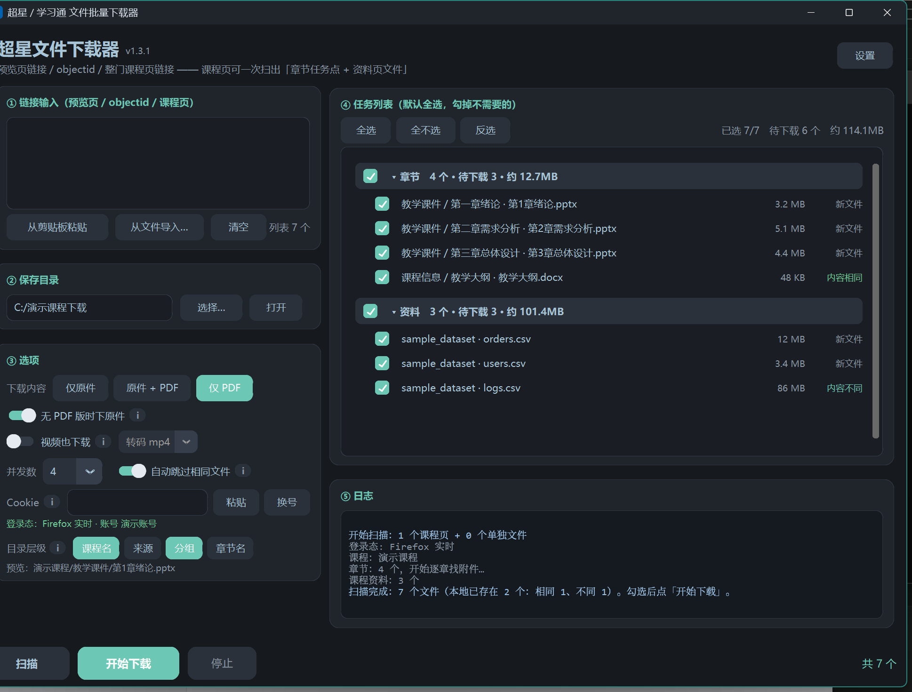
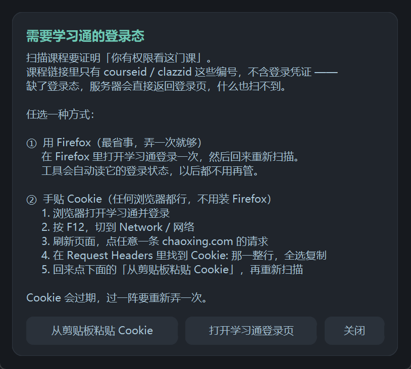

# 超星文件下载器

给**超星学习通**课程批量下载课件的小工具（**Windows / macOS / Linux**）。

粘课程页链接 → 扫描出全部附件 → 勾选 → 一键下载。**章节任务点**和**「资料」页**两个入口一起扫，
本地已下过的自动跳过。



## 目录

- [功能](#功能)
- [快速开始](#快速开始)
- [登录态](#登录态)
- [使用流程](#使用流程)
- [常见问题](#常见问题)
- [已知限制](#已知限制)
- [命令行版](#命令行版)
- [开发者文档](#开发者文档)
- [免责声明](#免责声明)
- [License](#license)

## 功能

| | |
| --- | --- |
| **两个入口一起扫** | 章节任务点 + 「资料」页（递归展开文件夹） |
| **一章多张卡片全扫** | PPT / 习题集 / 案例 / 课程思政等卡片逐张展开，不会只扫到第一张 |
| **自动查重** | 本地已有且**内容相同**的文件自动跳过（字节数 + 前 64KB md5） |
| **原件 / PDF** | 只下原件、只下 PDF、或两个都要；没 PDF 版的格式可自动下原件 |
| **视频可选** | 默认跳过；可选取转码 mp4（小）或原件（画质最好） |
| **多账号** | 登录态显示当前账号；「换号」列出 Firefox 里读到的多个账号 |
| **目录层级可选** | 课程名 / 来源 / 分组 / 章节名，勾哪级建哪级，实时预览落点 |
| **扫描缓存 + 并发** | 10 分钟内重复扫同一门课秒开；章节并发请求（24 章约 10 秒） |
| **失败重试 + 队列恢复** | 失败项一键重试；任务和勾选状态自动保存，重开程序接着下 |
| **设置页** | 主题色（色板 / 系统色盘）、外观、扫描缓存、检查更新、GitHub 入口 |
| **支持作者** | 设置页角落的入口，点开并排显示微信 / 支付宝收款码（不自动弹窗） |

## 快速开始

### 方式一：免安装包

从 [Releases](../../releases) 下载对应平台的文件，**不需要装 Python**：

| 平台 | 文件 | 备注 |
| --- | --- | --- |
| Windows | `cx-downloader-<版本>-windows.exe` | 双击运行；PyInstaller 单文件包，杀软误报很常见，加白名单即可 |
| macOS | `cx-downloader-<版本>-macos` | 终端里 `chmod +x` 后运行（单文件可执行程序，不是 `.app`） |
| Linux | `cx-downloader-<版本>-linux` | `chmod +x` 后运行；系统需有 `libtk8.6` / `libtcl8.6` |

<details>
<summary>macOS 报「已损坏 / 无法验证开发者」怎么办</summary>

```bash
cd ~/Downloads
chmod +x cx-downloader-v1.3.1-macos
xattr -d com.apple.quarantine cx-downloader-v1.3.1-macos   # 报 No such xattr 可忽略
./cx-downloader-v1.3.1-macos
```

也可以**右键 → 打开**放行一次。官方包是 **arm64**，Intel Mac 若报
`Bad CPU type in executable`，请改用下面的「方式二」。

</details>

### 方式二：跑源码（三平台通用）

```bash
pip install customtkinter
python cx_download_gui.py
```

> Linux 需要 tkinter：Debian/Ubuntu `python3-tk`、Fedora `python3-tkinter`、Arch `tk`。

<details>
<summary>Linux 桌面图标（可选）</summary>

```bash
cp dist/超星文件下载器 ~/.local/bin/cx-downloader
install -Dm644 packaging/cx-downloader.desktop ~/.local/share/applications/cx-downloader.desktop
```

</details>

## 登录态

**课程链接里没有登录凭证。** `courseid / clazzid / cpi / enc` 只回答「看哪门课」，
身份靠 Cookie；缺了它服务器只会返回登录页。链接请从浏览器**地址栏整条复制**（带 `enc`）。

**① 用 Firefox（推荐）**

在 Firefox 里登录一次学习通即可。工具会优先读**运行中的 Firefox**（Marionette 调试端口），
连只在内存里、还没写盘登录票据也能拿到，启动后直接显示账号名。Firefox 没开调试端口时，
「换号」里有「让 Firefox 开启实时读取」按钮，会重启一次浏览器（标签页自动恢复）。

**② 手动粘贴 Cookie（任何浏览器）**

1. 浏览器登录学习通，按 `F12` → **Network / 网络**
2. 刷新页面，点任意一条 `chaoxing.com` 请求
3. 在 **Request Headers** 里复制 `Cookie:` 那一整行
4. 回到工具点「粘贴」（直接粘整段请求头也行）

> Cookie 会过期，过一阵需要重新弄一次。

**多个账号**：点「换号」会列出实时 Cookie + 各 Firefox profile / 容器里的账号，选哪个用哪个。
一个 profile 通常只保留一个号的登录态，想同时存多个号需要多个 profile / 容器。



## 使用流程

1. **复制课程链接**：进课程后从地址栏整条复制（带 `enc`）。
2. **粘贴**到顶部输入框（支持多行；粘一整段文字也能自动识别链接）。
3. **选保存目录**：落点会实时预览。
4. **按需改选项**（一般默认即可）：

   | 选项 | 说明 |
   | --- | --- |
   | 下载内容 | 仅原件 / 原件+PDF / 仅 PDF。PDF 是学习通转好的预览版 |
   | 无 PDF 版时下原件 | csv / py / ipynb / npy / xlsx 不转 PDF，开着才下得到（默认开） |
   | 视频也下载 | 默认跳过；可选转码 mp4（几十 MB）或原件（几百 MB 到 1GB） |
   | 并发数 | 同时下几个，默认 4 |
   | 自动跳过相同文件 | 建议勾上 |
   | 目录层级 | 勾哪级建哪级目录 |

5. **点「扫描」**：章节任务点 + 资料页一次列出（按来源分组，可折叠）。
6. **勾选后点「开始下载」**：看进度条和日志，可随时停止；失败项可一键重试。

> 扫描有 10 分钟缓存；同一门课 2 分钟内再点一次「扫描」会强制刷新。

## 常见问题

| 现象 | 原因 / 解决 |
| --- | --- |
| 扫出来 0 个文件 / 提示需要登录 | 先解决登录态；课程链接要带 `enc` 参数 |
| 视频扫不到 | 视频任务点默认跳过，去选项里打开「视频也下载」 |
| 扫到的文件不是最新的 | 10 分钟扫描缓存；再点一次「扫描」强制刷新，或在设置里关掉缓存 |
| 明明下过，重扫还是「新文件」 | 查重按「保存目录 + 层级 + 下载模式」算，任一变化就重算 |
| 「仅 PDF」时 csv/py/xlsx 全跳过 | 打开「无 PDF 版时下原件」 |
| 扫出来是别人的课 | 看登录态那行的账号名，点「换号」切换 |
| 「换号」里看不到刚登录的号 | 点「让 Firefox 开启实时读取」重启浏览器；或直接粘 Cookie |
| Safari / Chrome 能自动读吗 | 不能，只自动读 Firefox；其它浏览器请手贴 Cookie |
| macOS 提示已损坏 / 双击没反应 | 见「快速开始」里的 macOS 说明 |

## 已知限制

- **视频要手动开**：测验、讨论仍然没有可下载文件。
- **附件解析靠 `data` 属性**：学习通换成完全不同的结构时需要跟着调。
- **查重是「字节数 + 前 64KB md5」**：极端情况下可能误判，课件场景可忽略。
- **不支持 Chrome / Edge 自动读 Cookie**：加密方案不稳定，而且读浏览器 cookie 库容易被杀软拦。
- **自动读登录态只认 Firefox**，其它浏览器请手贴 Cookie。
- **macOS 未打包成 `.app`**：能跑，但双击体验一般。
- **Linux 包依赖系统 Tk 运行库**；极简发行版请改用源码方式。

## 命令行版

`cx_download.py` **只依赖标准库**（不需要 customtkinter / tkinter）：

```bash
# 单个文件（预览页链接或 32 位 objectid）
python cx_download.py "https://mooc1.chaoxing.com/ananas/modules/pub/preview.html?objectid=xxxx"

# 整门课：章节 + 资料，按课程名建子目录
python cx_download.py "https://mooc2-ans.chaoxing.com/mooc2-ans/mycourse/stu?courseid=..&clazzid=..&cpi=.."

# 只扫章节
python cx_download.py <课程链接> --no-data
```

| 参数 | 作用 |
| --- | --- |
| `-f, --files` | 从文本文件读链接（每行一条，支持 `#` 注释） |
| `--clip` | 从剪贴板读 |
| `-o, --out DIR` | 保存目录（默认 `./cx_download`） |
| `--pdf` / `--pdf-only` | 只要 PDF |
| `--pdf-fallback` | 配合 `--pdf-only`：没有 PDF 版的格式下原件 |
| `--jobs N` | 并发数（默认 4） |
| `--cookie STR` | 手动 Cookie（默认自动读 Firefox） |
| `--video` / `--video-original` | 下视频 / 下视频原件 |
| `--overwrite` | 强制重下已存在的文件 |
| `--timeout N` | 单请求超时秒数（默认 60） |

> 命令行版给课程页链接时会**同时扫章节和资料**并直接下载；要挑着下请用 GUI。

## 开发者文档

<details>
<summary>打包成单文件程序</summary>

```bash
# Windows
pip install pyinstaller
pwsh -NoProfile -File build.ps1

# Linux / macOS
pip install pyinstaller
bash build.sh
```

产物在 `dist/超星文件下载器`（Windows 为 `dist\超星文件下载器.exe`，约 14.5 MB）。

构建脚本会校验源文件、生成图标、按 `cx-download.spec` 打包，并用出货程序自己跑
`--selftest` 验依赖收集 / HTTPS / 写盘。

```bash
build.ps1 -SkipSelftest      # 只打包
build.ps1 -NoNetwork         # 自检不联网
build.sh --skip-selftest     # Linux / macOS 同理
```

**发版**：`.github/workflows/build.yml` 是三平台矩阵；推 `main` 只上传 artifact，
打 tag `vX.Y.Z` 会三平台构建并挂到同一个 Release：

```bash
git tag vX.Y.Z && git push origin vX.Y.Z
```

</details>

<details>
<summary>项目结构</summary>

```
cx_download.py              核心：链接解析、课程扫描、下载（纯标准库，可当 CLI）
cx_download_gui.py          CustomTkinter 界面
selftest.py                 冻结自检，跑在出货程序内部
build.ps1 / build.sh        Windows / Linux+macOS 打包
cx-download.spec            PyInstaller 规格
make_icon.py                生成 app.ico（macOS 另出 app.icns）
packaging/cx-downloader.desktop   Linux 桌面入口模板
.github/workflows/build.yml 三平台构建 / 发版
docs/                       README 截图
历史版本/                    每次较大改动的源码快照 + 说明
```

</details>

<details>
<summary>技术备忘（踩过的坑）</summary>

- `/ananas/status/` 的 `crc` **不是内容哈希**，查重改用字节数 + 前 64KB md5（靠 HTTP Range）。
- 章节附件有三种 HTML 写法，按 class 名认会漏；现在统一抓 `data="{...objectid...}"`。
- 一章拆成多张卡片时按 `num` 逐张请求，越界页 `<title>` 为空，连空两张即停。
- 视频任务点字段和文档不同：有 `http`（转码）/ `download`（原件），没有 `pdf`。
- `CTkCheckBox` 的 `width` 收不住，目录层级那排用自绘按钮。
- 普通 Tk 字体不跟 CTk 的 DPI 缩放，悬停气泡要按 `ScalingTracker` 换算成像素字号。
- `Canvas.create_window()` 的 widget 必须是该 Canvas 的子控件。
- `_fit_geometry` 要连位置一起算，否则窗口会被摆到屏幕外。
- 查重必须按「实际落盘路径」算（模式 + 目录层级）。

</details>

<details>
<summary>历史版本（回滚 / 复盘）</summary>

每次较大改动都会把**改动前那一版**存进 `历史版本/`，并配 `README-历史版本说明.md`
（为什么改 / 改了啥 / 前后对比 / 回滚方法）。

| 版本 | 改了什么 |
| --- | --- |
| v1 | 界面换成 CustomTkinter |
| v3 | 支持整门课程页，自动扫章节任务点 |
| v4 | 「扫描 → 勾选 → 下载」，加内容查重 |
| v5 | 加「资料」页扫描（递归文件夹） |
| v6 | 任务列表分组折叠、目录层级可选 |
| v7 | 登录态引导、Cookie 一键粘贴 |
| v8 | 适配 macOS / Linux + 三平台 CI |
| v11 | 附件不再按 class 名抓；视频下载；账号名显示 |
| v12 | 一章多张卡片逐张扫描（习题集漏扫修复） |
| v13 | 设置页与主题色盘、扫描缓存 + 并发、失败重试 + 队列持久化 |

</details>

逐版本的用户可见变更见 [CHANGELOG.md](CHANGELOG.md)。

## 免责声明

仅供**下载自己有权访问的课程资料**、方便离线复习。请遵守学校规定和平台服务条款，
不要用于传播或商业用途。

## License

[MIT](LICENSE)
