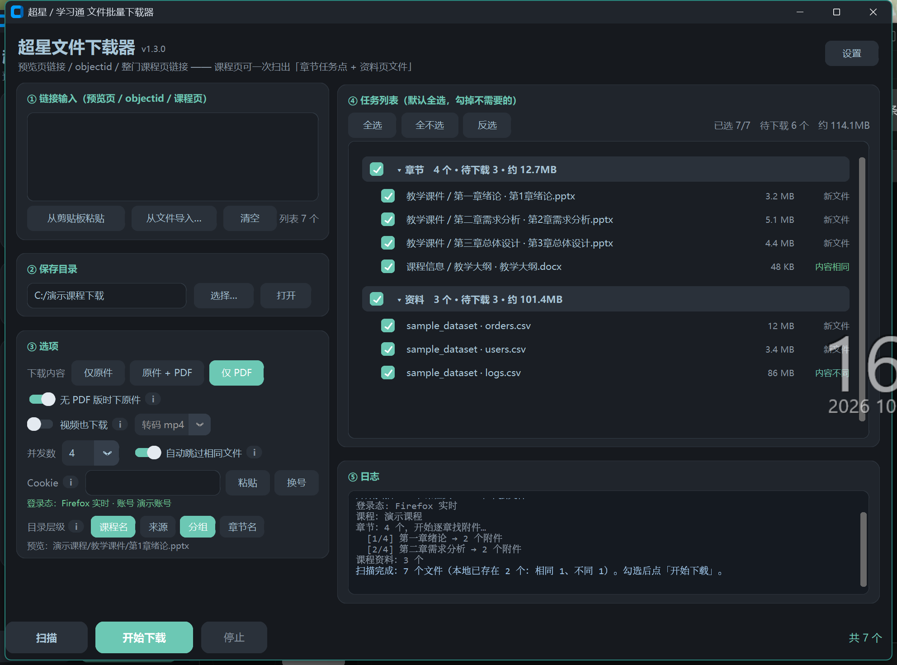

# 超星文件下载器

一个给**超星学习通**课程批量下载课件的小工具（**Windows / macOS / Linux**）。

粘贴课程页链接 → 扫描出全部附件 → 勾选要的 → 一键下载。
**章节任务点**和**「资料」页**两个入口都会扫，本地已下过的自动跳过。



---

## 它解决什么

学习通把课件散落在两个地方，而且都不让你痛快地下载：

- **章节页**：每个任务点是个在线预览的 PPT/PDF，得一个个点开、复制链接；
- **资料页**：文件夹里的东西连预览都没有，只能一个一个手点。

这个工具把两个入口都扫出来列成一张表，让你挑着下。一门 11 个课件的课，
从"点十几次 + 复制十几次链接"变成"粘一次链接 → 点两下"。

---

## 功能

| | |
| --- | --- |
| **两个入口一起扫** | 章节任务点 + 「资料」页（递归展开文件夹） |
| **附件解析跟得上改版** | 学习通三种模板（`ans-attach-online` / `ans-attach-ct` / `insertdoc`）都认，不靠 class 名 |
| **先扫再挑** | 列表默认全选，不需要的取消勾选 |
| **按来源分组** | 「章节」「资料」两组，可折叠，组头显示个数 / 体积 / 待下载数 |
| **自动查重** | 本地已有且**内容相同**的文件自动跳过；按实际落点（模式 + 层级）判定 |
| **原件 / PDF** | 可只下原件、只下 PDF、或两个都要；「仅 PDF」时 csv/py 这类没 PDF 版的自动下原件 |
| **视频可选** | 默认跳过；打开后可选取**转码 mp4**（小、能直接播）或**原件**（画质最好、体积大） |
| **账号看得见** | 登录态那行显示当前账号姓名，旁边「换号」一键切回 Firefox 登录态 |
| **目录层级可选** | 课程名 / 来源 / 分组 / 章节名，四级自由勾选，实时预览落点 |
| **命令行版** | `cx_download.py` 只用标准库，可以塞进脚本里 |
| **可打包** | 一条 `build.ps1` 出单文件 exe，自带冻结自检 |

---

## 快速开始

### 方式一：直接用免安装包

从 [Releases](../../releases) 下载对应平台的文件，双击 / 直接运行，**不需要装 Python**：

| 平台 | 文件 | 备注 |
| --- | --- | --- |
| Windows | `cx-downloader-<版本>-windows.exe` | 双击即可；PyInstaller 单文件包，**杀软误报很常见**，需要的话加白名单 |
| macOS | `cx-downloader-<版本>-macos` | 命令行里 `chmod +x` 后运行；单文件 Unix 可执行程序（暂未做成 `.app`） |
| Linux | `cx-downloader-<版本>-linux` | `chmod +x` 后运行；系统需有 `libtk8.6` / `libtcl8.6`（多数桌面发行版自带） |

> Windows 版首次启动要解压到 `%TEMP%\_MEIxxxx`，会慢几秒。
> Linux 桌面集成见下面「Linux / macOS」。

#### macOS 安装步骤

macOS 的免安装包是**单文件可执行程序，不是 `.app`**，双击体验一般，建议从「终端」启动：

```bash
cd ~/Downloads
chmod +x cx-downloader-v1.1.0-macos
xattr -d com.apple.quarantine cx-downloader-v1.1.0-macos   # 报 No such xattr 可忽略
./cx-downloader-v1.1.0-macos
```

- `chmod +x`：赋予可执行权限。
- `xattr -d com.apple.quarantine`：去掉下载时打的隔离标记，绕过
  「已损坏 / 无法验证开发者」弹窗；也可以**右键 → 打开**放行一次。
- 想省事可以改短名再放好：`mv cx-downloader-v1.1.0-macos ~/cx-downloader`，
  之后在任意目录敲 `~/cx-downloader` 启动。
- **芯片**：官方包在 Apple 芯片（M 系列）的机器上构建，属 **arm64**。
  **Intel Mac** 运行若报 `Bad CPU type in executable`，请改用下面「方式二：跑源码」。

### 方式二：跑源码（三平台通用）

```bash
pip install customtkinter
python cx_download_gui.py
```

> Linux 上需要 `tkinter`：Debian/Ubuntu 装 `python3-tk`，Fedora 装 `python3-tkinter`，
> Arch 装 `tk`。macOS 官方 Python 自带。

### Linux / macOS

跑源码或免安装包都行。想在应用菜单里点图标启动（Linux），把构建产物丢进 `PATH`
再装个 `.desktop`：

```bash
cp dist/超星文件下载器 ~/.local/bin/cx-downloader
install -Dm644 packaging/cx-downloader.desktop ~/.local/share/applications/cx-downloader.desktop
install -Dm644 app_preview.png ~/.local/share/pixmaps/cx-downloader.png   # 可选：图标
```

---

## 登录态（**最容易卡住的地方**）

**课程链接里没有登录凭证。** 链接里的 `courseid / clazzid / cpi / enc` 只回答
「要看哪门课」，不回答「你是谁」——真正证明身份的是 Cookie。
缺了登录态，服务器直接返回登录页，什么也扫不到。

> 另外，课程页链接要从浏览器**地址栏整条复制**（带上 `enc` 参数）。
> 只抄 `courseid=...` 之类的片段可能扫不全。

任选一种方式：

**① 用 Firefox（最省事）**
在 Firefox 里打开学习通登录一次就行，之后工具会自动读取它的登录状态。
（Firefox 的 cookie 是明文存在 `cookies.sqlite` 里的，读起来不需要解密。）

**② 手贴 Cookie（任何浏览器都行，不用装 Firefox）**

1. 浏览器打开学习通并登录
2. 按 `F12`，切到 **Network / 网络**
3. 刷新页面，点任意一条 `chaoxing.com` 的请求
4. 在 **Request Headers** 里找到 `Cookie:` 那一整行，全选复制
5. 回到工具点「粘贴」（直接粘整段请求头也行，会自动截取），再重新扫描

> Cookie 会过期，过一阵要重新弄一次。

**换账号**：手动填的 Cookie 优先于 Firefox 登录态。在浏览器里换了号，就点 Cookie 右边的
「换号」—— 清掉手动 Cookie、重读 Firefox、刷新账号名。登录态那行会显示**当前账号姓名**，
扫出来的东西和预期不符时，先看这行是不是你要的号。

界面上每个 `ⓘ` 圆圈鼠标悬停都会展开对应的说明，不用记这些。


---

## 使用流程（粘 → 扫 → 挑 → 下）

1. **复制课程链接**：浏览器进学习通那门课，从**地址栏整条复制**（要带 `enc`）。
2. **粘贴**：粘到程序最上面的输入框（可一行一个多条；粘带链接的一整段文字也会自动识别）。
3. **选保存目录**：点「选择」挑文件夹；落点会在下方「预览」里实时显示。
4. **设置选项**（一般保持默认即可）：
   - **下载内容**：仅原件 / 原件+PDF / 仅 PDF —— 原件是老师传的 pptx/docx/pdf，PDF 是学习通转好的预览版；
   - **仅 PDF 时，无 PDF 版的格式也下原件**：csv / py / ipynb / npy / xlsx 这些格式学习通不转 PDF，
     选「仅 PDF」时本来一个都下不到；开着这个开关它们就下原件（默认开）；
   - **视频也下载**：视频任务点默认跳过；打开后选取法 ——
     **转码 mp4**（学习通压好的，几十 MB，普通播放器能放，画质被压过）或
     **原件**（老师传的那份，画质最好，几百 MB 到 1GB，`.mov` 可能还要装解码器）。
     实测同一门课：原件 809.7MB → 转码 33.8MB。视频体积大，建议单独下一批；
   - **并发数**：同时下几个，默认 4，网络差就调小；
   - **自动跳过相同文件**：建议勾上，已下过且内容相同的会跳过；
   - **Cookie**：留空自动读 Firefox，读不到再手贴；
   - **目录层级**：课程名 / 来源 / 分组 / 章节名，勾哪级建哪级。
5. **点「扫描」**：章节任务点 + 「资料」页一次扫出，列成一张表（按来源分组，
   组头显示个数 / 体积 / 待下载数）。弹出「需要登录态」就按上一节处理。
6. **勾选**：列表默认全选，不需要的取消勾选；组可以折叠。
7. **点「开始下载」**：看进度条和日志，中途可「停止」；下完点「打开目录」直达文件夹
   （macOS 调 `open`）。

> 大文件（比如几百 MB 的 CSV）会比较慢，期间别关窗口。

---

## 命令行版

`cx_download.py` **只依赖标准库**，不用装 customtkinter（Linux 上也无需 tkinter）：

```bash
# 单个文件（公开预览链接或 32 位 objectid）
python cx_download.py "https://mooc1.chaoxing.com/ananas/modules/pub/preview.html?objectid=xxxx"

# 整门课：章节任务点 + 资料页，按课程名建子目录
python cx_download.py "https://mooc2-ans.chaoxing.com/mooc2-ans/mycourse/stu?courseid=..&clazzid=..&cpi=.."

# 只扫章节，不扫资料
python cx_download.py <课程链接> --no-data

# 其它
-f, --files      从文本文件读链接（每行一条，支持 # 注释）
--clip           从剪贴板读
-o, --out DIR    保存目录（默认 ./cx_download）
--pdf / --pdf-only
--jobs N         并发数（默认 4）
--cookie STR     手动指定 Cookie（默认自动读 Firefox）
--pdf-fallback   配合 --pdf-only：没有 PDF 版的格式改下原件
--video          视频任务点也下载（默认取转码 mp4）
--video-original 配合 --video：下原件而不是转码 mp4
--overwrite      强制重下已存在的文件
--timeout N      单请求超时秒数（默认 60）
```

**注意**：给课程页链接时命令行版会**同时扫章节和资料**，不再弹出勾选界面 ——
要挑着下请用 GUI。

---

## 打包成单文件程序

三平台各有一个构建脚本，参数语义一致：

```bash
# Windows
pip install pyinstaller
pwsh -NoProfile -File build.ps1

# Linux / macOS
pip install pyinstaller
bash build.sh
```

产物在 `dist/超星文件下载器`（Windows 上是 `dist\超星文件下载器.exe`，约 31 MB）。

> `build/` 和 `dist/` 都在 `.gitignore` 里：31 MB 的二进制进了 git 历史就永久撑大仓库，
> 而且每次构建都不一样。**要发给别人请挂到 GitHub Releases**，别提交进仓库。

构建脚本会：

1. 校验源文件齐全
2. 缺图标就调 `make_icon.py` 生成（macOS 还会出 `.icns`）
3. 按 `cx-download.spec` 打包（`--collect-all customtkinter` 是必须的，
   它的主题 JSON / 字体是**数据文件**，漏了会白屏且不报错）
4. **用出货的那个程序自己跑 `--selftest`**，验依赖收集 / HTTPS / 写盘

```bash
pwsh -File build.ps1 -SkipSelftest     # 只打包
pwsh -File build.ps1 -NoNetwork        # 自检不联网
pwsh -File build.ps1 -SelftestOids <oid>,<oid>   # 换自检样例

bash build.sh --skip-selftest             # Linux / macOS 同理
bash build.sh --no-network
bash build.sh --oids <oid>,<oid>
```

### 自动构建 / 发版

`.github/workflows/build.yml`（矩阵：`ubuntu-latest` / `windows-latest` / `macos-latest`）：

| 触发 | 行为 |
| --- | --- |
| 推 `main` / 手动触发 | 三平台各构建一份，作为 workflow artifact 上传（不发 Release） |
| 打 tag `v*` | 三平台构建并**自动挂到同一个 Release** |

发版就两条命令：

```bash
git tag vX.Y.Z
git push origin vX.Y.Z
```

> CI 里跑的是 `-NoNetwork`：自检的联网部分要去下载两个学习通公开预览文件，
> 样例随时可能失效，**CI 不该依赖外部服务** —— 只验打包完整性
> （core 符号齐全 / customtkinter 资源齐全 / GUI 可导入）就够了。

---

## 项目结构

```
cx_download.py              核心：链接解析、课程扫描、下载（纯标准库，可单独当 CLI 用）
cx_download_gui.py          CustomTkinter 界面
selftest.py                 冻结自检，跑在出货的程序内部
build.ps1                   Windows 打包 + 自检
build.sh                    Linux / macOS 打包 + 自检
cx-download.spec            PyInstaller 规格（图标按平台选）
make_icon.py                生成 app.ico（macOS 上再出 app.icns）
packaging/cx-downloader.desktop   Linux 桌面入口（模板）
.github/workflows/build.yml 三平台矩阵构建 / 发版
app.ico
docs/                       README 用的截图
历史版本/                    每次较大改动的存档（该版本的源码 + README 说明）
```

---

## 更新日志

逐版本的用户可见变更见 [CHANGELOG.md](CHANGELOG.md)。
`历史版本/` 里存的则是各版本的**源码快照 + 设计说明**（用于回滚和复盘）。

---

## 历史版本

每做一次推倒重来式的改动，都会把**改动前那一版**原样存档，并配一份
`README-历史版本说明.md`，写清：为什么改、改了哪些文件、改动前后的结果对比、
对下游的影响、怎么回滚。

| 版本 | 目录 | 改了什么 |
| --- | --- | --- |
| v1 | `历史版本/GUI改CustomTkinter-v1-20260916/` | 界面从 tkinter/ttk 换成 CustomTkinter |
| v3 | `历史版本/课程页批量下载-v3-20260916/` | 支持整门课程页：自动扫章节任务点 |
| v4 | `历史版本/扫描勾选下载-v4-20260916/` | 改成「扫描 → 勾选 → 下载」，加内容查重 |
| v5 | `历史版本/资料页扫描-v5-20260916/` | 加「资料」页扫描（递归文件夹） |
| v6 | `历史版本/分组折叠-v6-20260917/` | 任务列表按来源分组可折叠；目录层级可选；修「扫完改保存目录不生效」 |
| v7 | `历史版本/登录态引导-v7-20260917/` | 登录态引导弹窗、Cookie 一键粘贴、ⓘ 悬停说明 |
| v8 | `历史版本/多平台发行-v8-20260921/` | 适配 macOS / Linux：Firefox 路径、字体、`xdg-open` 跨平台；加 `build.sh` 与三平台 CI |
| v11 | `历史版本/附件解析修复-v11-20261021/` | 附件不再按 class 名抓（学习通三种写法，旧逻辑漏 41/57）；查重按实际落点；视频下载；账号名显示 +「换号」 |

---

## 技术备忘

几个踩过的坑，都写在对应的历史版本 README 里：

- **`/ananas/status/` 返回的 `crc` 不是文件内容的哈希**（md5/sha1 都对不上），
  所以查重改用 **字节数 + 前 64KB 的 md5**，靠 `d0.cldisk.com` 的 HTTP Range 支持
  只取 64KB，不用整包重下。
- **`CTkCheckBox` 的最小宽度收不住**：`width` 填 70、实际 `winfo_reqwidth()` 是 122，
  一排四个会把列撑爆 —— 所以目录层级那排是自绘的 `CTkButton`。
- **普通 Tk 字体不跟 CTk 的 DPI 缩放走**：CTk 的 `12` 在 175% 缩放下是 21px，
  Tk 的 `10` 是 10 磅 ≈ 13px。悬停气泡要按 `ScalingTracker` 换算成像素字号
  （Tk 里负数 = 像素）。
- **`Canvas.create_window()` 用的 widget 必须是这个 Canvas 的子控件**，
  挂到 Toplevel 上的话窗口项不渲染，表现为气泡是空的一块。
- **`_fit_geometry` 只设尺寸不够**：窗口默认由系统随便摆，高一点的会被摆到屏幕外，
  底部按钮就看不见了 —— 得连位置一起算并夹在屏幕内。
- **章节附件有三种 HTML 写法**（老 `ans-attach-online`、新 `ans-attach-ct` 套
  `downloadfile` iframe、编辑器插的 `ans-insertdoc-retract`），按 class 名认会漏一大半。
  现在统一抓 `data="{...objectid...}"` 再解析 JSON，按 objectid 去重。
- **视频任务点的状态字段和文档不一样**：有 `http`（转码 mp4，几十 MB）、`download`
  （原件，几百 MB）、`dtoken`/`duration`/`mp3`，但没有 `download/pdf` 这套文档地址。
- **查重要按「实际落盘路径」算**：模式（`仅 PDF` 落 `.pdf`）+ 目录层级（分组/章节子目录）
  任一不同，都会导致「明明下过却全标新文件」。

---

## 常见问题（FAQ）

| 现象 | 原因 / 解决 |
| --- | --- |
| macOS 提示「已损坏 / 无法验证开发者」 | 被 Gatekeeper 拦了，不是文件坏。执行 `xattr -d com.apple.quarantine <文件>`，或右键 → 打开放行一次 |
| macOS 报 `Bad CPU type in executable` | Intel Mac 跑不了 arm64 的包，改用「方式二：跑源码」 |
| 双击没反应 / 一闪而过 | 它不是 `.app`，请在**终端**里运行，才能看到界面和报错 |
| 扫出来 0 个文件 / 提示需要登录 | 先解决登录态；课程链接要带 `enc` 参数 |
| 课程里有视频却扫不到 | 视频任务点默认跳过，去选项里打开「视频也下载」；打开后能选转码 mp4 或原件 |
| 明明下过，重扫还是全标「新文件」 | 查重按「保存目录 + 层级勾选 + 下载模式」算，三者任一变了就重算；v1.2.0 起会按 `.pdf` 落盘名和分组子目录去找 |
| 之前下过又重下 | 同上；命令行可加 `--overwrite` 强制重下 |
| 「仅 PDF」时 csv/py/xlsx 全失败 | v1.2.0 起默认下原件（选项「无 PDF 版时下原件」）；关掉则标「跳过」 |
| 下出来的是别人的课 / 课程列表不对 | 看登录态那行显示的账号名，点「换号」清掉手动 Cookie 重新读 Firefox |
| Cookie 又失效了 | Cookie 有时效，重新获取一次；用 Firefox 只要它还登录着就不用管 |
| Safari / Chrome 能自动读登录态吗 | 不能，只自动读 Firefox；其它浏览器请手贴 Cookie |

---

## 已知限制

- **视频要手动开**：视频任务点默认跳过，选项里打开「视频也下载」才下；取的是学习通
  转码好的 mp4（几十 MB）或原件（几百 MB 到 1GB）。测验、讨论仍然没有可下载文件。
- **附件解析靠 `data` 属性**：学习通换模板时只要仍带 `data="{...objectid...}"` 就能认；
  真改成完全不同的结构，还得跟着调（`ATTACH_DATA_RE`）。
- **查重是「字节数 + 前 64KB md5」**，理论上存在前 64KB 相同、总字节数也相同的
  不同文件被误判 —— 对课件场景可以忽略。
- **不支持 Chrome / Edge 自动读 cookie**，也不打算做：Chrome 127+ 的
  App-Bound Encryption 一更新就可能失效，而且「读浏览器 cookie 库 + 解 DPAPI」
  是信息窃取木马的标准行为，杀软基本会拦。手贴 Cookie 已经覆盖所有浏览器。
- **登录页识别靠特征字符串**（`LOGIN_MARKERS`），学习通改版可能要跟着调。
- 「资料」页的下载直链是从行内 HTML 抓的（`operate_down` 这个 class），
  改版同样要跟着调。
- **自动读取的登录态只认 Firefox**（Linux / macOS / Windows 都支持 Firefox，
  含 snap 版）。其它浏览器请手贴 Cookie —— 平台无关。
- **macOS 只出单文件可执行程序，暂未做成 `.app` 应用包**：能跑，但从 Finder
  双击的体验不如正规 `.app`（可能需要右键「打开」绕过 Gatekeeper）。
- **Linux 免安装包依赖系统有 Tk 运行库**（`libtk8.6` / `libtcl8.6`）；极简发行版
  上若缺，改用源码方式（装 `python3-tk`）即可。

---

## 免责声明

仅供**下载自己有权访问的课程资料**、方便离线复习使用。
请遵守所在学校的规定和平台的服务条款，不要用于传播或商业用途。

---

## License

[MIT](LICENSE)
