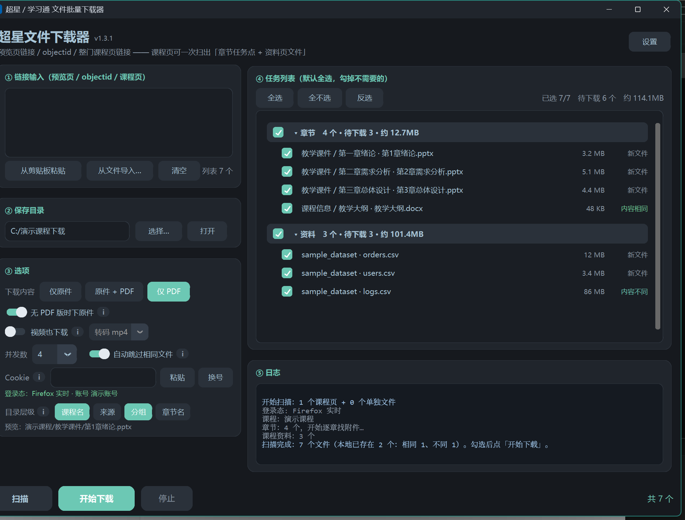
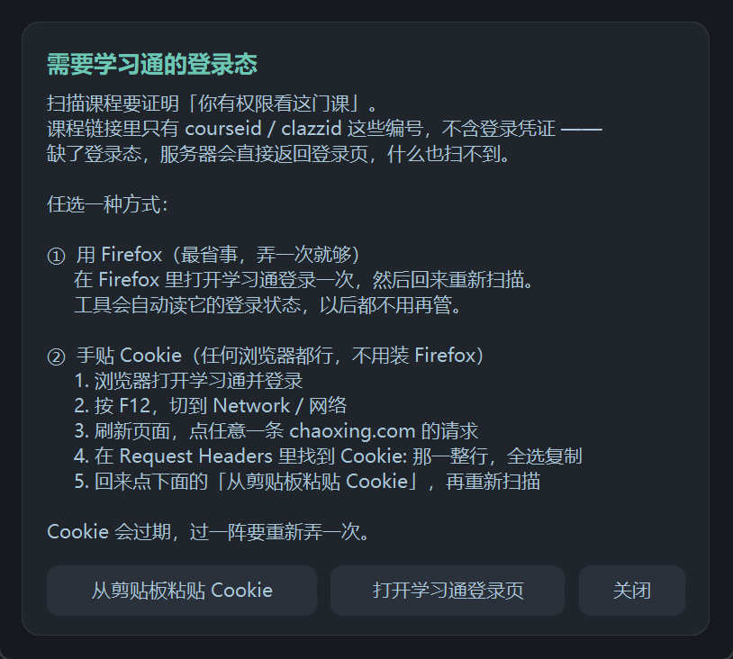

# 超星文件下载器

给**超星学习通**课程批量下载课件的小工具（**Windows / macOS / Linux**）。

粘课程页链接 → 扫描出全部附件 → 勾选 → 一键下载。**章节任务点**和**「资料」页**两个入口一起扫，
本地已下过的自动跳过。



## 目录

- [功能](#功能)
- [快速开始](#快速开始)
- [登录态](#登录态)
- [使用流程](#使用流程)
- [更新与升级](#更新与升级)
- [常见问题](#常见问题)
- [已知限制](#已知限制)
- [命令行版](#命令行版)
- [开发者文档](#开发者文档)
- [免责声明](#免责声明)
- [License](#license)

## 功能

| | |
| --- | --- |
| **两个入口一起扫** | 章节任务点 + 「资料」页（递归展开文件夹） |
| **一章多张卡片全扫** | PPT / 习题集 / 案例 / 课程思政等卡片逐张展开，不会只扫到第一张 |
| **自动查重** | 本地已有且**内容相同**的文件自动跳过（字节数 + 前 64KB md5） |
| **原件 / PDF** | 只下原件、只下 PDF、或两个都要；没 PDF 版的格式可自动下原件 |
| **视频可选** | 默认跳过；可选取转码 mp4（小）或原件（画质最好） |
| **多账号** | 登录态显示当前账号；「换号」列出 Firefox 里读到的多个账号 |
| **目录层级可选** | 课程名 / 来源 / 分组 / 章节名，勾哪级建哪级，实时预览落点 |
| **扫描缓存 + 并发** | 10 分钟内重复扫同一门课秒开；章节并发请求（24 章约 10 秒） |
| **失败重试 + 队列恢复** | 失败项一键重试；任务和勾选状态自动保存，重开程序接着下 |
| **自动更新** | 启动检查新版本；Windows 版可一键下载、校验、替换自身并重启（支持断点续传） |
| **设置页** | 主题色（色板 / 系统色盘）、外观、扫描缓存、检查更新、GitHub 入口 |
| **支持作者** | 设置页角落的入口，点开并排显示微信 / 支付宝收款码（不自动弹窗） |

## 快速开始

### 方式一：免安装包

从 [Releases](../../releases) 下载对应平台的文件，**不需要装 Python**：

| 平台 | 文件 | 备注 |
| --- | --- | --- |
| Windows | `cx-downloader-<版本>-windows.exe` | 双击运行；PyInstaller 单文件包，杀软误报很常见，加白名单即可 |
| macOS | `cx-downloader-<版本>-macos` | 单文件可执行程序（不是 `.app`），按下面步骤在终端运行 |
| Linux | `cx-downloader-<版本>-linux` | `chmod +x` 后运行；系统需有 `libtk8.6` / `libtcl8.6` |

**GitHub 打不开或下载很慢**：Windows 版在 Gitee 上有镜像，直接到
<https://gitee.com/yum0rin/cx-downloader-update/releases> 下载同名 exe；
macOS / Linux 版目前只在 GitHub Release，需要翻到 GitHub 取。

#### macOS 完整安装步骤（照着敲就行）

下载下来的是一个**没有扩展名的可执行文件**，macOS 不允许直接双击，需要从「终端」启动。
下面每一步都用键盘**手动敲**，不要从网页或聊天里复制——复制常会带上反引号 `` ` `` 或
看不到的空格，导致命令报错。

**1. 打开文件所在的文件夹**

浏览器下载的文件一般在「下载 / Downloads」。在访达里进去，记下文件名，例如
`cx-downloader-v1.4.8-macos`（版本名以你实际下载到的为准）。

**2. 打开终端**

按 `Command + 空格` 搜「终端」（Terminal），回车打开。

**3. 进入下载文件夹**（敲完按回车）

```bash
cd ~/Downloads
```

**4. 给文件加执行权限**（只需做一次）

```bash
chmod +x cx-downloader-v1.4.8-macos
```

> `+x` 和文件名之间**必须有一个空格**。写成 `chmod +xcx-downloader...`
> 会报 `usage: chmod ...`，不会有其它后果，补上空格重敲即可。
> 文件名可以只敲前几个字母后按 `Tab` 让终端自动补全，最保险。

**5. 运行**

```bash
./cx-downloader-v1.4.8-macos
```

界面弹出来就成了。以后再打开，重复第 3、5 步即可，第 4 步不用再做。

<details>
<summary>第 5 步弹出「无法验证开发者 / 已损坏」的窗口怎么办</summary>

这是 macOS 的 Gatekeeper 拦截，不是文件坏了。两种方式任选其一：

- **方式 A**：点弹窗上的「完成」→ 到访达的「下载」里**右键**该文件 →「打开」→
  再弹出的窗口里点「打开」。以后就不会再拦。
- **方式 B**：终端里先执行下面这行去掉隔离标记，再重复第 5 步
  （报 `No such xattr` 可忽略）：

```bash
xattr -d com.apple.quarantine cx-downloader-v1.4.8-macos
```

</details>

<details>
<summary>常见报错对照</summary>

| 报错 | 原因 / 解决 |
| --- | --- |
| `usage: chmod ...` | `chmod +x` 后面漏了空格，或把反引号一起复制进去了。手动敲，加空格 |
| `command not found: ls` / `no such file or directory` | 命令是从网页复制的，带了隐藏字符。手动敲 |
| `no such file or directory: ./cx-downloader...` | 不在文件所在目录，或文件名敲错。重做第 3 步，用 `Tab` 补全文件名 |
| `Bad CPU type in executable` | 官方包是 **arm64**（Apple 芯片）。Intel Mac 请用下面的「方式二」跑源码 |
| 扫描日志报 `CERTIFICATE_VERIFY_FAILED` / `self-signed certificate` | v1.4.8 起已内置修复，不用再手动设环境变量。老版本可临时用 `SSL_CERT_FILE=/etc/ssl/cert.pem ./cx-downloader-<版本>-macos` 启动 |

</details>

### 方式二：跑源码（三平台通用）

```bash
pip install customtkinter
python cx_download_gui.py
```

> Linux 需要 tkinter：Debian/Ubuntu `python3-tk`、Fedora `python3-tkinter`、Arch `tk`。

<details>
<summary>Linux 桌面图标（可选）</summary>

```bash
cp dist/超星文件下载器 ~/.local/bin/cx-downloader
install -Dm644 packaging/cx-downloader.desktop ~/.local/share/applications/cx-downloader.desktop
```

</details>

## 登录态

**课程链接里没有登录凭证。** `courseid / clazzid / cpi / enc` 只回答「看哪门课」，
身份靠 Cookie；缺了它服务器只会返回登录页。链接请从浏览器**地址栏整条复制**（带 `enc`）。

**① 用 Firefox（推荐）**

在 Firefox 里登录一次学习通即可。工具会优先读**运行中的 Firefox**（Marionette 调试端口），
连只在内存里、还没写盘登录票据也能拿到，启动后直接显示账号名。Firefox 没开调试端口时，
「换号」里有「让 Firefox 开启实时读取」按钮，会重启一次浏览器（标签页自动恢复）。

**② 手动粘贴 Cookie（任何浏览器）**

1. 浏览器登录学习通，按 `F12` → **Network / 网络**
2. 刷新页面，点任意一条 `chaoxing.com` 请求
3. 在 **Request Headers** 里复制 `Cookie:` 那一整行
4. 回到工具点「粘贴」（直接粘整段请求头也行）

> Cookie 会过期，过一阵需要重新弄一次。

**多个账号**：点「换号」会列出实时 Cookie + 各 Firefox profile / 容器里的账号，选哪个用哪个。
一个 profile 通常只保留一个号的登录态，想同时存多个号需要多个 profile / 容器。



## 使用流程

1. **复制课程链接**：进课程后从地址栏整条复制（带 `enc`）。
2. **粘贴**到顶部输入框（支持多行；粘一整段文字也能自动识别链接）。
3. **选保存目录**：落点会实时预览。
4. **按需改选项**（一般默认即可）：

   | 选项 | 说明 |
   | --- | --- |
   | 下载内容 | 仅原件 / 原件+PDF / 仅 PDF。PDF 是学习通转好的预览版 |
   | 无 PDF 版时下原件 | csv / py / ipynb / npy / xlsx 不转 PDF，开着才下得到（默认开） |
   | 视频也下载 | 默认跳过；可选转码 mp4（几十 MB）或原件（几百 MB 到 1GB） |
   | 并发数 | 同时下几个，默认 4 |
   | 自动跳过相同文件 | 建议勾上 |
   | 目录层级 | 勾哪级建哪级目录 |

5. **点「扫描」**：章节任务点 + 资料页一次列出（按来源分组，可折叠）。
6. **想一次查完整个账号**：点「扫描全部课程」，会列出账号全部课程
   （标进行中 / 未开始 / 已结束，按开课时间排序），勾选后逐门检查，
   结果显示**已有 / 有更新 / 未下载**；视频 / 安装包 / 压缩包 / 大文件
   单独成组、默认不勾，检查完弹窗问是否一起下载。
7. **勾选后点「开始下载」**：看进度条和日志，可随时停止；失败项可一键重试。

> **「扫描」和「扫描全部课程」有什么区别**：
> 「扫描」检查**输入框里粘的**课程链接；「扫描全部课程」自动列出**账号所有课程**，
> 让你勾选后批量检查。两者都会按课程名找到本地课程文件夹、递归比对（不管子目录层级），
> 结果分「已有 / 有更新 / 未下载」。整学期盘一遍用「扫描全部课程」。

> 扫描有 10 分钟缓存；同一门课 2 分钟内再点一次「扫描」会强制刷新。

## 更新与升级

启动 1.5 秒后自动查一次更新，有新版就弹窗（也可以在
「设置 → 关于 → 检查更新」手动查）。版本信息来自多个源并行查询：
用户配置的境内更新清单、GitHub API、GitHub Release 页跳转。
配了境内清单时它有 1.5 秒优先窗口（校园网常见「API 通、但资产 CDN 挂」，
必须优先用境内清单才能拿到镜像下载地址）；境内源没回才按谁快谁赢，
所以某个源挂掉也不会让用户干等。

**Windows 打包版可以一键更新：**

1. 弹窗里点「一键更新」下载新 exe（约 14.5MB）。**支持断点续传**：下到一半超时或断网，
   残包会留在 `%TEMP%`，再点一次「一键更新」从断点接着下，不用从头来。
2. 下完先校验大小、PE 头和 sha256（Release 提供摘要时），再自动退出。
3. 后台批处理等程序进程结束后覆盖原 exe 并重新启动。**设置、登录态、下载队列都保留**，
   不需要重新配置。

**替换失败怎么办**：程序装在 `Program Files` 等需要管理员权限的目录，或者 exe 被杀软
占用时，覆盖会失败。这时启动后会弹窗说明「没换成」，并给出新版本所在的临时路径 ——
关闭程序后把那个 exe 复制覆盖原文件即可。也可以直接在更新弹窗点「浏览器下载」手动替换。

**macOS / Linux / 源码运行**：弹窗里只有「下载新版本」，浏览器下载后自行替换；
配置文件 `~/.cx_download_gui.json` 不受影响。

### 用 Gitee 镜像更新（境外不通 / 下载卡住时用这个，最简单）

本项目在 Gitee 上备了一份**现成的境内更新源**，你只需要填一次地址：

1. 打开「**设置 → 关于**」，在「境内更新源」框里粘贴这一行：

   ```
   https://gitee.com/yum0rin/cx-downloader-update/raw/master/latest.json
   ```

2. 保存设置，点「**检查更新**」——新版本信息会从 Gitee 读，比走 GitHub 快且稳。
3. 弹窗里点「**一键更新**」。exe 同样优先从 **Gitee Release 附件**下载（境内直连），
   下完校验大小和 sha256 后自动替换、重启，**设置、登录态、下载队列都保留**。

之后每次有新版都不用再管，自动提醒 + 一键更新走的就是这个境内源。

> 弹窗里的「**浏览器下载**」打开的是 Release 页（GitHub）。如果 GitHub 打不开，
> 直接去上面的 Gitee 镜像仓库另存新 exe，再用「设置 → 关于 → 从本地文件更新…」
> 选中它，同样会校验后自动替换。

macOS / Linux 用户这个源只帮你拿到版本说明和下载地址，仍需浏览器下载后自行替换文件。

**完全连不上 GitHub 也连不上 Gitee 时**：在能上网的设备上下载好新 exe，
用「设置 → 关于 → 从本地文件更新…」选中它，校验通过后自动替换并重启。

下载 exe 时如果有多个地址（清单里可以给多个 `assets`），会按顺序逐个尝试，
换源前清掉上一个源的残包；同一次下载里的断点续传照旧有效。

<details>
<summary>更新清单协议（latest.json）</summary>

放在任意境内可达的静态托管上即可，程序只发 GET，不需要服务端脚本。
发布新版本时把它和 GitHub Release 一起更新，否则会停在旧版本。

```json
{
  "version": "1.4.5",
  "tag": "v1.4.5",
  "name": "v1.4.5",
  "body": "这一版的更新说明（纯文本或 Markdown）",
  "url": "https://example.com/releases",
  "published_at": "2026-11-14",
  "assets": [
    {
      "name": "cx-downloader-v1.4.5-windows.exe",
      "url": "https://example.com/cx-downloader-v1.4.5-windows.exe",
      "size": 15575745,
      "sha256": "这里填 exe 的 sha256 十六进制"
    }
  ]
}
```

- `assets` 里也可以直接写 URL 字符串（此时没有大小和摘要，只校验 PE 头）。
- 多个 `assets` = 多个下载地址，会逐个回退。
- `sha256` 写不写都行；写了就按它校验，比只看大小更可靠。

</details>

<details>
<summary>自建 Gitee 镜像源（维护者向，普通用户不用看）</summary>

本项目已在 Gitee 维护好一个公开镜像仓库，用户按上面填那一行地址即可，无需自建；
只有自己托管时才需要下面的步骤。

```powershell
# 1. 从 GitHub Release 生成清单，--asset-base 指向你的 Gitee Release 附件目录
python packaging/make_update_manifest.py `
  --tag v1.4.8 `
  --asset-base "https://gitee.com/<owner>/<repo>/releases/download/{tag}"
```

```bash
# 2. 把 packaging/latest.json 推到 Gitee 仓库，再建同名 tag + Release，
#    上传 exe 作为附件（Windows 产物名必须是 cx-downloader-<tag>-windows.exe）
```

- **15MB 的 exe 不能放仓库 raw**：Gitee 对公开仓库大于 10MB 的原始数据要求登录（403），
  必须走 Release 附件。
- `--asset-base` 会让清单输出同一 exe 的两个地址（Gitee 在前、GitHub 在后），下载器按顺序回退。
- Gitee raw 有 60~300 秒缓存：同步后别立刻验证，或换个文件名绕开。
- 清单同步完记得把 `packaging/latest.json` 一起提交回主仓库。

</details>

**提醒的两种关闭方式**：「稍后再说」只是关掉这次，下次启动还会提醒；
「不再提示此版本」只忽略当前版本，下个版本仍会弹。

## 常见问题

> 使用交流 / 反馈问题：QQ 群 **1129676506**（设置页里也有一键复制）。

| 现象 | 原因 / 解决 |
| --- | --- |
| 扫出来 0 个文件 / 提示需要登录 | 先解决登录态；课程链接要带 `enc` 参数 |
| 视频扫不到 | 视频任务点默认跳过，去选项里打开「视频也下载」 |
| 扫到的文件不是最新的 | 10 分钟扫描缓存；再点一次「扫描」强制刷新，或在设置里关掉缓存 |
| 明明下过，重扫还是「新文件」 | 用「检查本地」：按课程名递归查整个课程文件夹，不受子目录层级影响；主名不中再按字节数兜底 |
| 「仅 PDF」时 csv/py/xlsx 全跳过 | 打开「无 PDF 版时下原件」 |
| 扫出来是别人的课 | 看登录态那行的账号名，点「换号」切换 |
| 「换号」里看不到刚登录的号 | 点「让 Firefox 开启实时读取」重启浏览器；或直接粘 Cookie |
| Safari / Chrome 能自动读吗 | 不能，只自动读 Firefox；其它浏览器请手贴 Cookie |
| macOS 提示已损坏 / 双击没反应 | 见「快速开始 → macOS 完整安装步骤」及 Gatekeeper 处理方式 |
| macOS 报错 `usage: chmod` / `command not found` | 命令复制时带了反引号或隐藏字符；改为手动敲，`+x` 后留一个空格 |
| macOS 扫描报 `CERTIFICATE_VERIFY_FAILED` | v1.4.8 起已内置修复；老版本临时加 `SSL_CERT_FILE=/etc/ssl/cert.pem` 启动 |

## 已知限制

- **视频要手动开**：测验、讨论仍然没有可下载文件。
- **附件解析靠 `data` 属性**：学习通换成完全不同的结构时需要跟着调。
- **查重是「字节数 + 前 64KB md5」**：极端情况下可能误判，课件场景可忽略。
- **不支持 Chrome / Edge 自动读 Cookie**：加密方案不稳定，而且读浏览器 cookie 库容易被杀软拦。
- **自动读登录态只认 Firefox**，其它浏览器请手贴 Cookie。
- **macOS 未打包成 `.app`**：能跑，但双击体验一般。
- **Linux 包依赖系统 Tk 运行库**；极简发行版请改用源码方式。

## 命令行版

`cx_download.py` **只依赖标准库**（不需要 customtkinter / tkinter）：

```bash
# 单个文件（预览页链接或 32 位 objectid）
python cx_download.py "https://mooc1.chaoxing.com/ananas/modules/pub/preview.html?objectid=xxxx"

# 整门课：章节 + 资料，按课程名建子目录
python cx_download.py "https://mooc2-ans.chaoxing.com/mooc2-ans/mycourse/stu?courseid=..&clazzid=..&cpi=.."

# 只扫章节
python cx_download.py <课程链接> --no-data

# 只检查本地（不下载）：按课程名找本地目录，递归比对
python cx_download.py <课程链接> --check-local --local-root "D:\课程"

# 检查后只补未下载的普通文件（视频/安装包/压缩包/大文件默认不下）
python cx_download.py <课程链接> --check-local --download-missing
```

| 参数 | 作用 |
| --- | --- |
| `-f, --files` | 从文本文件读链接（每行一条，支持 `#` 注释） |
| `--clip` | 从剪贴板读 |
| `-o, --out DIR` | 保存目录（默认 `./cx_download`） |
| `--check-local` | 只检查本地，不下载 |
| `--local-root DIR` | 本地课程根目录（默认同 `--out`） |
| `--download-missing` | 配合 `--check-local`：只补未下载的普通文件 |
| `--include-special` | 特殊/大文件（视频/安装包/压缩包/大文件）也一起下 |
| `--large-mb N` | 大文件阈值（默认 100 MB） |
| `--report-json FILE` | 检查结果写 JSON |
| `--pdf` / `--pdf-only` | 只要 PDF |
| `--pdf-fallback` | 配合 `--pdf-only`：没有 PDF 版的格式下原件 |
| `--jobs N` | 并发数（默认 4） |
| `--cookie STR` | 手动 Cookie（默认自动读 Firefox） |
| `--video` / `--video-original` | 下视频 / 下视频原件 |
| `--overwrite` | 强制重下已存在的文件 |
| `--timeout N` | 单请求超时秒数（默认 60） |

> 命令行版给课程页链接时会**同时扫章节和资料**并直接下载；要挑着下请用 GUI。

## 开发者文档

<details>
<summary>打包成单文件程序</summary>

```bash
# Windows
pip install pyinstaller
pwsh -NoProfile -File build.ps1

# Linux / macOS
pip install pyinstaller
bash build.sh
```

产物在 `dist/超星文件下载器`（Windows 为 `dist\超星文件下载器.exe`，约 14.5 MB）。

构建脚本会校验源文件、生成图标、按 `cx-download.spec` 打包，并用出货程序自己跑
`--selftest` 验依赖收集 / HTTPS / 写盘。

```bash
build.ps1 -SkipSelftest      # 只打包
build.ps1 -NoNetwork         # 自检不联网
build.sh --skip-selftest     # Linux / macOS 同理
```

**发版**：`.github/workflows/build.yml` 是三平台矩阵；推 `main` 只上传 artifact，
打 tag `vX.Y.Z` 会三平台构建并挂到同一个 Release：

```bash
git tag vX.Y.Z && git push origin vX.Y.Z
```

</details>

<details>
<summary>项目结构</summary>

```
cx_download.py              核心：链接解析、课程扫描、下载（纯标准库，可当 CLI）
cx_download_gui.py          CustomTkinter 界面
selftest.py                 冻结自检，跑在出货程序内部
build.ps1 / build.sh        Windows / Linux+macOS 打包
cx-download.spec            PyInstaller 规格
make_icon.py                生成 app.ico（macOS 另出 app.icns）
packaging/cx-downloader.desktop   Linux 桌面入口模板
.github/workflows/build.yml 三平台构建 / 发版
docs/                       README 截图
历史版本/                    每次较大改动的源码快照 + 说明
```

</details>

<details>
<summary>技术备忘（踩过的坑）</summary>

- `/ananas/status/` 的 `crc` **不是内容哈希**，查重改用字节数 + 前 64KB md5（靠 HTTP Range）。
- 章节附件有三种 HTML 写法，按 class 名认会漏；现在统一抓 `data="{...objectid...}"`。
- 一章拆成多张卡片时按 `num` 逐张请求，越界页 `<title>` 为空，连空两张即停。
- 视频任务点字段和文档不同：有 `http`（转码）/ `download`（原件），没有 `pdf`。
- `CTkCheckBox` 的 `width` 收不住，目录层级那排用自绘按钮。
- 普通 Tk 字体不跟 CTk 的 DPI 缩放，悬停气泡要按 `ScalingTracker` 换算成像素字号。
- `Canvas.create_window()` 的 widget 必须是该 Canvas 的子控件。
- `_fit_geometry` 要连位置一起算，否则窗口会被摆到屏幕外。
- 查重必须按「实际落盘路径」算（模式 + 目录层级）。

</details>

<details>
<summary>历史版本（回滚 / 复盘）</summary>

每次较大改动都会把**改动前那一版**存进 `历史版本/`，并配 `README-历史版本说明.md`
（为什么改 / 改了啥 / 前后对比 / 回滚方法）。

| 版本 | 类型 | 改了什么 |
| --- | --- | --- |
| 1.0.0 | 大版本 | 界面换成 CustomTkinter |
| 1.0.0 | 大版本 | 支持整门课程页，自动扫章节任务点 |
| 1.0.0 | 大版本 | 「扫描 → 勾选 → 下载」，加内容查重 |
| 1.0.0 | 大版本 | 加「资料」页扫描（递归文件夹） |
| 1.0.0 | 大版本 | 任务列表分组折叠、目录层级可选 |
| 1.0.0 | 大版本 | 登录态引导、Cookie 一键粘贴 |
| 1.1.0 | 大版本 | 适配 macOS / Linux + 三平台 CI |
| 1.1.1 | 小版本 | 修「原生 PDF 被误报失败」 |
| 1.1.2 | 小版本 | 断点续传；视频任务点标「跳过」 |
| 1.2.0 | 大版本 | 附件不再按 class 名抓；视频下载；账号名显示 |
| 1.2.1 | 小版本 | 一章多张卡片逐张扫描（习题集漏扫修复） |
| 1.3.0 | 大版本 | 设置页与主题色盘、扫描缓存 + 并发、失败重试 + 队列持久化 |
| 1.4.0 | 大版本 | 「检查本地」递归查重；特殊/大文件单独成组并询问是否下载 |

目录名就是「改动名-版本号-日期」，版本号与 Release 标签一致：中间那位进位是大版本（加功能），
最后一位进位是小版本（修问题）。

</details>

逐版本的用户可见变更见 [CHANGELOG.md](CHANGELOG.md)。

## 免责声明

仅供**下载自己有权访问的课程资料**、方便离线复习。请遵守学校规定和平台服务条款，
不要用于传播或商业用途。

## License

[MIT](LICENSE)

